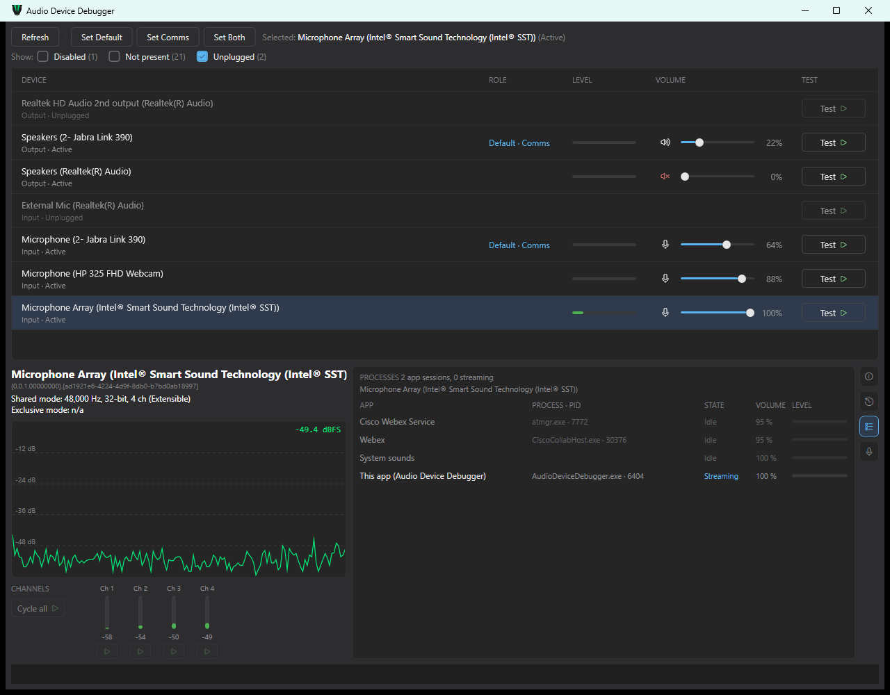

# Windows Audio Device Debugger

[](https://github.com/heironeous/WinAudioDebugTool/actions/workflows/build-and-tag.yml)

A Windows desktop tool for finding out what's really going on with your audio devices: every input and output
Windows knows about, which one is the default, who is using it, what format it runs at, what processing Windows
applies to your microphone — and quick tests to check that a speaker or mic actually works.

Built for the "why isn't my mic/speaker working", "which of these five USB headsets is actually active" and "why
does my headset sound terrible in calls" situations, where Windows' own Sound settings only give you a name and a
default toggle.



*The device list (roles, live levels, volume and mute, Test buttons) and, below it, the selected laptop mic array:
its formats, rolling dB level graph, per-channel meters, and the PROCESSES tab listing the apps that have it open.*

## Features

**Device list**
- Every audio endpoint, including disabled, not-present and unplugged ones (filter them with the **Show:**
  checkboxes), with its role badge (Default · Comms), a live level meter, volume slider and mute button.
- Updates by itself when devices are plugged in or removed, or when another app changes a volume.
- "· In use by *App*" when another application is streaming to or from the device.

**Defaults** — make the selected device the default, the default *communications* device, or both.

**Tests**
- **Outputs:** play a short generated music clip (drums, bass, chords, melody), or play it on one speaker channel at
  a time (front left, centre, LFE, …) to check wiring and channel order.
- **Inputs:** record 5 seconds and play it back; then listen to each microphone channel on its own.

**Details** for the selected device: shared- and exclusive-mode formats, a rolling dB level graph, per-channel meters,
and whether the driver supports raw (unprocessed) capture.

**Side panel tabs** (right edge of the details area; one open at a time)
- **PROPERTIES** — the endpoint's full property store, with readable names for ~1,550 documented keys.
- **EVENTS** — a timeline of device changes, default switches, volume/mute changes (by Windows or by this app), apps
  starting and stopping streams, and tests. Filter it, copy it, or export it as CSV, Markdown or JSON Lines — handy
  for "my mic died in the meeting at 14:03".
- **PROCESSES** — which applications have the selected device open (app, process and PID, streaming or idle, the app's
  own volume, live level). Opening a Bluetooth/USB headset's mic is what switches it into low-quality "call mode", so
  this shows who is doing it.
- **RAW RECORDING** — **Record A/B** records the selected mic three ways *at the same time*: **Raw** (no
  processing), **Call** (what call apps such as Teams or Webex receive — i.e. what the other side hears, before the
  app's own processing) and **Standard** (what most apps get), then plays Raw and Call back to back. Each take shows
  its level, format, per-channel levels and the effects Windows applied (echo cancellation, noise suppression, …), and
  you can listen to each channel of each take — for example the individual capsules of a laptop mic array.

All levels are shown in dBFS (−60…0 dB).

## Requirements

- Windows 10 or 11, x64. Developed and tested on Windows 11.
- No admin rights needed.
- The effects list in RAW RECORDING needs Windows 11 (`IAudioEffectsManager`); raw capture needs a driver that
  supports it (the app tells you).
- To run the released exe: nothing else — it includes the .NET runtime.
- To build it yourself: the [.NET 8 SDK](https://dotnet.microsoft.com/download/dotnet/8.0).

## Getting it

### Download

Each version is published on the [Releases](https://github.com/heironeous/WinAudioDebugTool/releases) page.
Download `AudioDeviceDebugger-vX.Y.Z-win-x64.exe` from the latest release and run it — it's a single, self-contained
file (about 70 MB, because it includes the .NET runtime): no installer, no admin rights, nothing else to install.

- **Windows SmartScreen** may warn "Windows protected your PC", because the exe isn't code-signed. Click **More
  info → Run anyway** if you trust the download. Company-managed PCs may block unsigned executables altogether.
- To check the download wasn't corrupted or altered, compare its hash with the `.sha256` file next to it in the
  release:

  ```powershell
  Get-FileHash .\AudioDeviceDebugger-vX.Y.Z-win-x64.exe -Algorithm SHA256
  ```

### Build from source

```powershell
git clone https://github.com/heironeous/WinAudioDebugTool.git
cd WinAudioDebugTool\src\AudioDeviceDebugger
dotnet build -c Release
.\bin\Release\net8.0-windows\win-x64\AudioDeviceDebugger.exe
```

Or run it directly with `dotnet run` from `src\AudioDeviceDebugger`.

To produce a single self-contained `.exe` that runs on machines without .NET installed:

```powershell
cd src\AudioDeviceDebugger
dotnet publish -p:PublishProfile=win-x64-selfcontained
# → bin\Release\net8.0-windows\win-x64\publish\AudioDeviceDebugger.exe
```

(The same profile can be picked in Visual Studio's Publish dialog.)

## Good to know

- **Selecting a microphone opens it.** Windows only reports an input's level while something records from it, so
  the app keeps a silent capture stream open on the *selected* input (and only that one). On many Bluetooth/USB
  headsets, opening the mic switches the headset into call mode, which lowers playback quality while the mic is
  selected. Select an output device to release it.
- **Tests make sound.** Output tests and mic playback play through your speakers/headset at the current volume.
- **Your audio stays on your machine.** Recordings and the event log are kept in memory only and are gone when you
  close the app, unless you export the log yourself. Nothing is sent anywhere.
- **Set Default uses an undocumented Windows interface** (`IPolicyConfig`) — the same one Windows' own Sound settings
  use. It has been stable for many Windows versions, but Microsoft doesn't guarantee it.
- **Call ≠ exactly what the other side hears.** The Call take is what Windows and the driver deliver to call apps;
  Teams, Webex & co. add their own processing, a codec and the network on top. On many drivers Standard and Call use
  the same processing.
- **PROCESSES only sees shared-mode streams** going through the Windows audio engine; exclusive-mode streams may not
  show up. Very short streams (under ~0.5 s) can be missed.
- In a quiet room a microphone can read below the −60 dB meter floor and look dead — hover the meter for the exact
  dBFS value.

## Testing status

Every checked item in [TODO.md](TODO.md) was tested by hand on a Windows 11 laptop with Realtek speakers, an Intel
Smart Sound Technology 4-channel mic array and a Jabra Link 390 USB headset dongle. Other hardware — surround setups,
pro audio interfaces, directly paired Bluetooth headsets — hasn't been tried; reports are welcome.

A GitHub Actions workflow builds every push to `main` on Windows (except documentation-only pushes), tags it
with the next version and publishes it as a release (see "Versioning" below). There are no automated tests yet. Most of the code is a thin layer over live Windows Core Audio calls, which
can't be meaningfully unit-tested without real devices; the pure-logic parts (event log, exporters, level scale,
channel layout) are candidates for a test project.

A quick manual check after building:

1. The device list matches what Windows Sound settings shows; plugging/unplugging a USB headset updates it.
2. **Set Default / Set Comms** change the defaults, and Windows Sound settings agrees.
3. **Test** on an output plays from the right device; **Test** on a mic records and plays back what you said.
4. Meters move for several devices at once; the channel strip plays one speaker at a time.
5. EVENTS logs your volume changes and device switches; PROCESSES shows a call app or browser that has the mic open.
6. RAW RECORDING → **Record A/B**: the Raw and Call takes sound different and list different effects.

## Versioning

Versions follow [semantic versioning](https://semver.org/) and are derived from
[conventional commit](https://www.conventionalcommits.org/) messages by
`.github/workflows/build-and-tag.yml` (logic in `.github/scripts/next-version.sh`). On each push to `main` the
workflow publishes the self-contained exe and, if that succeeds, tags the commit with the next version and creates a
GitHub Release for the tag with the exe (`AudioDeviceDebugger-vX.Y.Z-win-x64.exe`) and its SHA-256 checksum
attached. The release notes list the commits since the previous release. The bump is chosen like this:

| Commits since the last tag include… | Bump | Example |
|---|---|---|
| a breaking change (`feat!:`, `fix!:`, … or a `BREAKING CHANGE:` footer) | major | v1.4.2 → v2.0.0 |
| a `feat:` | minor | v1.4.2 → v1.5.0 |
| only other types (`fix:`, `perf:`, `docs:`, `chore:`, …) | patch | v1.4.2 → v1.4.3 |

Pushes that only change documentation — Markdown files (`*.md`) and anything under `docs/` — don't run the
workflow, so they get no tag of their own; their commits are included in the next tag. A push that changes
documentation *and* anything else is built and tagged as usual.

The first tag uses the `<Version>` in `src/AudioDeviceDebugger/AudioDeviceDebugger.csproj` (0.1.0). The CI build
stamps the version into the executable (file and product version); local builds keep the `.csproj` version.

## Reporting problems

Please open an issue on GitHub with your Windows version, the device(s) involved, and — if relevant — the EVENTS log
exported as Markdown (Export… → `.md`). Note that endpoint IDs in the log can contain hardware serial numbers.

## How it works

- **C# / .NET 8, WPF** — a native Windows UI with direct access to the Core Audio COM APIs (`IMMDeviceEnumerator`,
  `IAudioEndpointVolume`, `IAudioMeterInformation`, `IAudioSessionManager2`, …).
- **[NAudio](https://github.com/naudio/NAudio) 2.2.1** for WASAPI playback/capture and most Core Audio wrappers.
- **Own COM interop** where NAudio has no API or is too slow: `IPolicyConfig` (setting defaults), `IAudioClient2`
  (raw and communications capture), `IAudioEffectsManager` (effects per stream), and direct property-store reads
  (NAudio's `FriendlyName` scans the whole store and takes ~0.5 s per device).

## Repository layout

```
├── .github/                     CI: build-and-tag workflow and its versioning script
├── README.md                    This file
├── TODO.md                      Feature checklist and roadmap
├── CLAUDE.md                    Notes for AI coding agents (architecture, pitfalls, conventions)
├── docs/design-notes.md         Implementation and verification notes for the larger features
├── docs/images/                 Screenshots used in this README
├── AudioDeviceDebugger.sln
├── src/AudioDeviceDebugger/     The WPF app (net8.0-windows)
│   ├── Interop/                 Raw COM interop (IPolicyConfig, IAudioClient2, property reads, property-key names)
│   ├── Models/                  Plain data (devices, formats, events, sessions, recordings)
│   ├── Services/                Core Audio work, no UI: enumeration, defaults, details, volume, level meters,
│   │                            tests and recordings, app sessions, event-log export
│   ├── ViewModels/              MVVM glue between services and views
│   ├── Views/                   MainWindow, LevelGraph, Theme.xaml (flat dark theme)
│   └── Assets/                  App icon
└── tools/PropertyKeyNameGenerator/   Regenerates the property-key name table
```

### Property-key names

The PROPERTIES tab shows each endpoint property by a readable name ("Device: Friendly Name") instead of its raw
`{fmtid},pid`. The names come from a table compiled into the app:

- `src/AudioDeviceDebugger/Interop/PropertyKeyNames.g.cs`: **generated** — every documented `PKEY_*` / `DEVPKEY_*` in
  the Windows SDK (~1,550 keys), read from Microsoft's
  [Win32 metadata](https://www.nuget.org/packages/Microsoft.Windows.SDK.Win32Metadata) package. Don't edit by hand;
  regenerate from the repo root with `dotnet run --project tools/PropertyKeyNameGenerator` (bump the package version in
  `tools/PropertyKeyNameGenerator/PropertyKeyNameGenerator.csproj` to pick up newer SDKs).
- `src/AudioDeviceDebugger/Interop/PropertyKeyNames.cs`: **hand-maintained** `ManualNames` for undocumented keys. Only
  add a key once its meaning is confirmed; unknown keys are shown by their raw `{fmtid},pid`.

## Contributing

Issues and pull requests are welcome. See [TODO.md](TODO.md) for the roadmap (bandwidth-based call-mode detection
and a diagnostic report export are specified there) and [CLAUDE.md](CLAUDE.md) for the hard-won lessons about
Core Audio, COM apartments and WPF that the code relies on — worth reading before changing services or interop.
